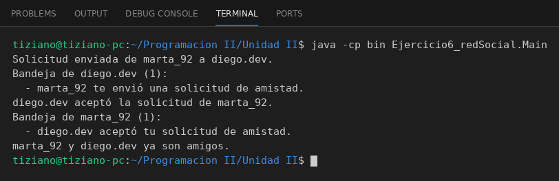

# RedSocial

Programación II - Unidad 2 - Ejercicio 6

## Consigna
Dos usuarios intercambian solicitudes de amistad mediadas por una RedSocial que despacha notificaciones.

## Lógica
- `Usuario`: `nombreUsuario`, lista de amigos y bandeja de notificaciones; `recibirNotificacion(String)`.
- `RedSocial.enviarSolicitud(remitente, receptor)`: valida que no sea el mismo usuario ni ya sean amigos, e invoca `receptor.recibirNotificacion(...)`.
- `aceptarSolicitud` hace amigos a ambos y notifica al remitente.
- `Main`: envía una solicitud, muestra la bandeja del receptor, la acepta y verifica la del remitente.

## Ejecución

